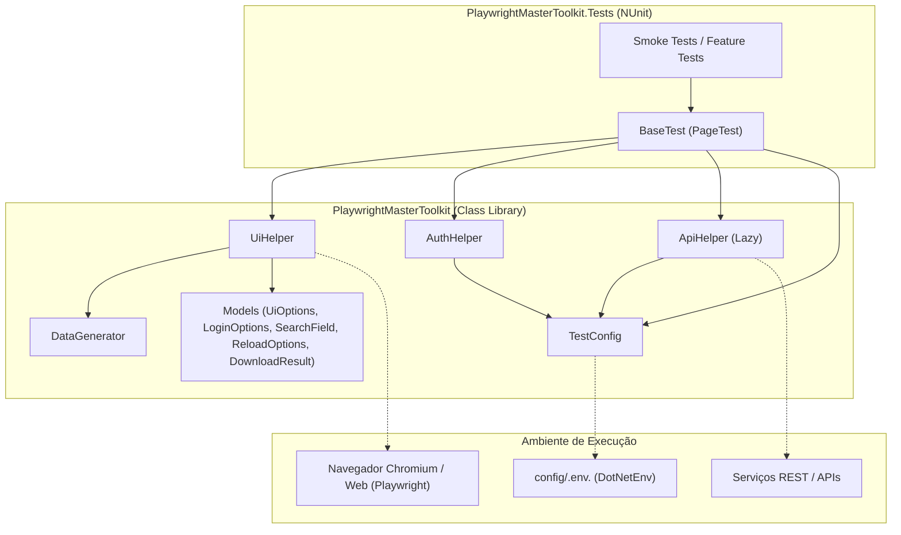

# 🎭 Playwright .NET Master Toolkit

<p align="center">
  <a href="https://github.com/mthsneves/playwright-dotnet-toolkit/actions/workflows/ci.yml">
    
  </a>
  <a href="LICENSE">
    
  </a>
  
  
  
  
</p>

<p align="center">
  <strong>Framework reutilizável e resiliente para automação de testes de ponta a ponta (E2E) e testes híbridos em C# (.NET 8) com Playwright e NUnit.</strong>
</p>

---

## 📑 Sumário

- [Visão Geral](#-visão-geral)
- [Arquitetura da Solução](#-arquitetura-da-solução)
- [Destaques e Recursos](#-destaques-e-recursos)
- [Pré-requisitos](#-pré-requisitos)
- [Estrutura do Repositório](#-estrutura-do-repositório)
- [Início Rápido (Quick Start)](#-início-rápido-quick-start)
- [Configuração Multi-Ambiente](#-configuração-multi-ambiente)
- [Execução dos Testes](#-execução-dos-testes)
- [Referência Completa da API](#-referência-completa-da-api)
  - [DataGenerator](#1-datagenerator-utilitário-estático)
  - [UiHelper](#2-uihelper-resiliência-de-interface)
  - [AuthHelper](#3-authhelper-autenticação-e-sessão)
  - [ApiHelper](#4-apihelper-cliente-http-e-data-seeding)
  - [BaseTest](#5-basetest-classe-base-para-testes)
  - [TestConfig](#6-testconfig-gerenciamento-de-configurações)
- [Exemplos de Testes E2E e Híbridos](#-exemplos-de-testes-e2e-e-híbridos)
- [Diferenças em Relação ao TypeScript](#-diferenças-em-relação-ao-typescript)
- [Boas Práticas de Automação](#-boas-práticas-de-automação)
- [Diagnóstico com Traces e Screenshots](#-diagnóstico-com-traces-e-screenshots)
- [Integração Contínua (CI/CD)](#-integração-contínua-cicd)
- [Como Reutilizar em Seu Projeto](#-como-reutilizar-em-seu-projeto)
- [Licença](#-licença)

---

## 💡 Visão Geral

O **Playwright .NET Master Toolkit** foi projetado para elevar o nível de maturidade e confiabilidade de projetos de automação em ecossistemas corporativos .NET. Ele resolve os principais desafios encontrados em testes E2E modernos:

- 🛡️ **Zero Esperas Cegas (`Thread.Sleep`)**: Respeita rigorosamente os mecanismos nativos de acionabilidade do Playwright (estabilidade, visibilidade, interceptação e habilitação).
- 🧩 **Testes Híbridos Ultrarrápidos (Data Seeding)**: Injeta dados no banco/serviço via API direta antes de abrir a UI, reduzindo o tempo de suítes de minutos para milissegundos.
- 🇧🇷 **Massa de Dados Realista para o Brasil**: Geração determinística de CPFs e CNPJs válidos (com cálculo real de dígitos verificadores mod 11), telefones celulares e e-mails com garantia de não colisão.
- 🔐 **Autenticação Resiliente**: Fluxo completo de login com tratamento de modais de sessões ativas concorrentes e suporte nativo a rotas SPA com hash (`/#/login`).
- 📊 **Diagnóstico Automático de Falhas**: Gravação de tracing interativo (.zip) e screenshots de tela cheia (.png) anexados automaticamente ao relatório do NUnit quando um teste falha.

---

## 📐 Arquitetura da Solução



---

## ✨ Destaques e Recursos

| Módulo | Objetivo Principal | Benefício |
|---|---|---|
| **`BaseTest`** | Classe base que herda de `PageTest` | Injeta `Ui`, `Auth` e `Api`, além de capturar traces e screenshots em falhas. |
| **`UiHelper`** | Ergonomia e resiliência em interações | Resolve autocompletes, downloads, digitação sequencial e recarregamento resiliente. |
| **`AuthHelper`** | Gestão de sessão corporativa | Trata conexões concorrentes, limpa cookies/storage e aguarda desvio de rotas de login. |
| **`ApiHelper`** | Injeção e consumo de APIs | Autenticação via API, extração de token JWT e `SeedRecordViaApiAsync<T>` genérico. |
| **`DataGenerator`** | Criação de dados para testes | Gera e valida CPFs, CNPJs, celulares e normaliza textos acentuados. |
| **`TestConfig`** | Multi-ambiente simplificado | Carrega `.env` subindo os diretórios até encontrar `config/`, sem travar caso ausente. |

---

## 🛠️ Pré-requisitos

1. [.NET SDK 8.0](https://dotnet.microsoft.com/download/dotnet/8.0) ou superior:
   ```bash
   dotnet --version
   ```
2. [PowerShell 7 (`pwsh`)](https://github.com/PowerShell/PowerShell):
   ```bash
   pwsh --version
   ```
3. [Git](https://git-scm.com/):
   ```bash
   git --version
   ```

---

## 📂 Estrutura do Repositório

```text
playwright-dotnet-toolkit/
├── .github/
│   └── workflows/
│       └── ci.yml                 # Pipeline CI/CD GitHub Actions
├── config/
│   ├── .env.example               # Template de variáveis versionado
│   └── .env.qa                    # Variáveis locais de QA (ignorado no git)
├── docs/
│   └── EXEMPLOS.md                # Exemplos práticos portados e detalhados
├── downloads/
│   └── .gitkeep                   # Diretório de persistência de downloads
├── src/PlaywrightMasterToolkit/
│   ├── Base/
│   │   └── BaseTest.cs            # Classe base abstrata derivada de PageTest
│   ├── Config/
│   │   └── TestConfig.cs          # Leitor de variáveis multi-ambiente (.env)
│   ├── Helpers/
│   │   ├── ApiHelper.cs           # Cliente HTTP e Data Seeding
│   │   ├── AuthHelper.cs          # Login resiliente e controle de sessão
│   │   └── UiHelper.cs            # Resiliência e ergonomia de UI
│   ├── Models/
│   │   ├── DownloadResult.cs      # Modelo de retorno de downloads
│   │   ├── LoginOptions.cs        # Opções de seletores e rotas de login
│   │   ├── ReloadOptions.cs       # Opções para recarregamento resiliente
│   │   ├── SearchField.cs         # Modelo para formulários de busca
│   │   ├── UiAction.cs            # Enum de ações suportadas
│   │   └── UiOptions.cs           # Opções de interação (Timeout, Force, Sequentially, etc.)
│   ├── Utils/
│   │   └── DataGenerator.cs       # Gerador e validador de massas de dados
│   └── PlaywrightMasterToolkit.csproj
├── tests/PlaywrightMasterToolkit.Tests/
│   ├── .runsettings               # Configurações do runner Playwright/NUnit
│   ├── Smoke/
│   │   ├── DataGeneratorTests.cs  # Testes de unidade do gerador de dados
│   │   ├── FixturesTests.cs       # Testes de injeção da base e mock de API
│   │   └── UiHelperTests.cs       # Testes E2E contra TodoMVC e componentes dinâmicos
│   ├── Usings.cs                  # Global Usings e paralelismo NUnit
│   └── PlaywrightMasterToolkit.Tests.csproj
├── CHANGELOG.md                   # Histórico de alterações e migrações
├── LICENSE                        # Licença MIT
├── PlaywrightMasterToolkit.sln    # Solução .NET
└── README.md                      # Documentação oficial
```

---

## ⚡ Início Rápido (Quick Start)

### 1. Clonar o repositório
```bash
git clone https://github.com/mthsneves/playwright-dotnet-toolkit.git
cd playwright-dotnet-toolkit
```

### 2. Restaurar dependências e compilar
```bash
dotnet build
```

### 3. Instalar o navegador Chromium
```powershell
pwsh tests/PlaywrightMasterToolkit.Tests/bin/Debug/net8.0/playwright.ps1 install chromium
```
*(No Linux, se faltarem dependências de SO: `install --with-deps chromium`)*

### 4. Executar os testes
```bash
dotnet test
```

---

## 🌍 Configuração Multi-Ambiente

O toolkit carrega automaticamente o arquivo `.env.<TEST_ENV>` a partir da pasta `config/` baseado na variável de ambiente `TEST_ENV` (padrão: `qa`).

Crie seu arquivo local a partir do modelo:
```bash
cp config/.env.example config/.env.qa
```

Edite `config/.env.qa`:
```properties
BASE_URL=https://demo.playwright.dev/todomvc
API_BASE_URL=https://api.exemplo.com
USER_EMAIL=usuario.qa@empresa.com
USER_PASSWORD=SenhaForte@123
```

> [!IMPORTANT]
> O arquivo `config/.env.example` é versionado no Git como referência. Arquivos de ambiente reais contendo senhas e chaves (`config/.env.*`) são ignorados pelo `.gitignore`.

---

## 🏃 Execução dos Testes

| Cenário de Execução | Comando |
|---|---|
| **Execução Padrão (Headless)** | `dotnet test` |
| **Especificando Ambiente (Linux/Mac)** | `TEST_ENV=staging dotnet test` |
| **Especificando Ambiente (PowerShell)** | `$env:TEST_ENV="staging"; dotnet test` |
| **Modo Visual (Headed)** | `$env:HEADED="1"; dotnet test` |
| **Filtrando por Categoria/Nome** | `dotnet test --filter "FullyQualifiedName~Smoke"` |
| **Com relatório detalhado no console** | `dotnet test --verbosity normal` |

---

## 📚 Referência Completa da API

### 1. `DataGenerator` (Utilitário Estático)

Gera e valida massas de dados dinâmicas sem dependências externas.

```csharp
using PlaywrightMasterToolkit.Utils;

// CPF válido com ou sem máscara
string cpfComMascara = DataGenerator.Cpf(mask: true);   // "123.456.789-09"
bool valido = DataGenerator.IsValidCpf(cpfComMascara);  // true

// CNPJ válido (filial matriz 0001)
string cnpj = DataGenerator.Cnpj(mask: true);           // "12.345.678/0001-90"
bool cnpjValido = DataGenerator.IsValidCnpj(cnpj);      // true

// E-mail único e celular formatado
string email = DataGenerator.Email("matheus", "empresa.com"); // "matheus.a8f9b2@empresa.com"
string celular = DataGenerator.Cellphone(mask: true);          // "(11) 98765-4321"

// Normalização de texto (remove acentos, caixa baixa e colapso de espaços)
string limpo = DataGenerator.NormalizeText("  Ação   Éxito "); // "acao exito"
```

### 2. `UiHelper` (Resiliência de Interface)

Acessível em qualquer teste que herde de `BaseTest` através da propriedade `Ui`.

- **`WaitForPageLoadAsync(bool waitForNetworkIdle = false)`**: Aguarda `DOMContentLoaded` e `Load`.
- **`InteractWithElementAsync(selector/locator, UiAction action, UiOptions? options = null)`**: Executa ações (`Click`, `Type`, `Clear`, `MouseOver`, `ContainsClick`, `ContainsSelectorClick`) com `Force = false` por padrão para respeitar verificações de acionabilidade.
- **`ClickWhenVisibleAndEnabledAsync(selector/locator, UiOptions? options = null)`**: Aguarda que o elemento esteja visível e habilitado antes do clique.
- **`SelectAutocompleteAsync(selector, value, bool type = false, UiOptions? options = null)`**: Digita sequencialmente com delay (`PressSequentiallyAsync`) e aguarda a visibilidade da opção (com fallback para MUI, AntDesign e tags `li`).
- **`SelectOptionWithTextAsync(selector, text, timeout = 30000)`**: Abre dropdown, seleciona o texto correspondente e pressiona `Escape` para fechar menus suspensos.
- **`ClickUntilVisibleAsync(clickSelector, targetSelector, timeout = 30000, intervalMs = 500)`**: Clica repetidamente até o alvo aparecer, tolerando re-renderizações e informando com precisão qual seletor faltou.
- **`ValidateTextInElementAsync(selector/locator, texts, timeout = 30000)`**: Executa asserções nativas `ToContainTextAsync` para múltiplos textos.
- **`SearchFormAsync(fields, submitButtonSelector = null)`**: Preenche formulários dinâmicos respeitando `OptionIndex`.
- **`ReloadUntilVisibleAsync(selector, expectedText, ReloadOptions? options = null)`**: Recarrega a página em loop inspecionando todos os elementos correspondentes via `AllTextContentsAsync()` e texto normalizado.
- **`ValidateDownloadDetailedAsync(trigger, saveTo = null)`**: Intercepta download nativo disparado pela ação, valida o arquivo físico e opcionalmente o salva na pasta `downloads/`.
- **Métodos Auxiliares de Preenchimento**: `FillGeneratedNameAsync`, `FillGeneratedCpfAsync`, `FillGeneratedCnpjAsync`, `FillGeneratedEmailAsync` e `FillGeneratedPhoneAsync` (preenchem e retornam o valor gerado).

### 3. `AuthHelper` (Autenticação e Sessão)

Acessível através da propriedade `Auth`.

- **`LoginPlatformAsync(email = null, password = null, LoginOptions? options = null)`**:
  - Limpa cookies e `localStorage`/`sessionStorage` de sessões passadas.
  - Navega para a rota de login preservando hash routing (`/#/login`).
  - Preenche o e-mail e valida com `ToHaveValueAsync`.
  - Aguarda o botão de envio estar habilitado antes do clique.
  - Executa polling assíncrono com `Stopwatch`: se a URL desviar da rota de login, retorna sucesso; se surgir modal de sessão concorrente ativa, confirma derrubada e aguarda; se exibir mensagem de erro, falha imediatamente.
- **`LogoutAsync(userMenuSelector = "#user-menu", logoutButtonSelector = "#btn-logout")`**: Abre o menu do usuário, aguarda o botão e limpa os estados do navegador.

### 4. `ApiHelper` (Cliente HTTP e Data Seeding)

Acessível através da propriedade lazy `Api` em `BaseTest` ou instanciado com `IAPIRequestContext`.

- **`LoginViaApiAsync(user, pass, loginEndpoint = "/api/v1/auth/login")`**: Autentica via POST e extrai o token JWT.
- **`SeedRecordViaApiAsync<T>(endpoint, payload, token = null)`**: Injeta dados via POST e desserializa o retorno em um DTO fortemente tipado usando `System.Text.Json` (com `PropertyNameCaseInsensitive = true`).

### 5. `BaseTest` (Classe Base para Testes)

Herdada por todas as suítes de teste:

```csharp
[Parallelizable(ParallelScope.Self)]
public abstract class BaseTest : PageTest
{
    public UiHelper Ui { get; }
    public AuthHelper Auth { get; }
    public ApiHelper Api { get; } // Lazy: exige API_BASE_URL apenas quando acessado
}
```

- **SetUp**: Configura timeouts padrão (20s ação, 30s navegação, 15s expect), viewport 1366x768, downloads habilitados e inicia gravação de tracing Playwright.
- **TearDown**: Em caso de falha do teste, captura screenshot em `screenshots/` e arquivo `.zip` de trace em `traces/`, anexando ambos ao relatório do NUnit.

### 6. `TestConfig` (Gerenciamento de Configurações)

Lê variáveis de ambiente com carregamento automático da pasta `config/`:
- `BaseUrl`: URL da aplicação (fallback: `https://demo.playwright.dev/todomvc`).
- `ApiBaseUrl`: URL base da API REST.
- `UserEmail` e `UserPassword`: Credenciais padrão.
- `GetRequired("NOME")`: Lança exceção explícita caso uma variável indispensável não tenha sido configurada.

---

## 🧪 Exemplos de Testes E2E e Híbridos

### Cenário 1: Autenticação Resiliente e Cadastro com Dados Dinâmicos
```csharp
using NUnit.Framework;
using PlaywrightMasterToolkit.Base;

[TestFixture]
public class CadastroClienteTests : BaseTest
{
    [Test]
    public async Task DeveCadastrarClienteComDadosUnicos()
    {
        // 1. Login com tratamento de sessão concorrente ativa
        await Auth.LoginPlatformAsync("usuario.qa@empresa.com", "SenhaForte@123");
        await Page.GotoAsync("/clientes/novo");

        // 2. Preenchimento de campos com massas não colidentes
        string nome = await Ui.FillGeneratedNameAsync("#txt-nome", "Cliente");
        string cnpj = await Ui.FillGeneratedCnpjAsync("#txt-cnpj", mask: true);
        string email = await Ui.FillGeneratedEmailAsync("#txt-email");
        string telefone = await Ui.FillGeneratedPhoneAsync("#txt-telefone", mask: true);

        // 3. Dropdown com busca e digitação sequencial
        await Ui.SelectAutocompleteAsync("#filtro-cidade", "São Paulo", type: true);

        // 4. Clique seguro no botão salvar
        await Ui.ClickWhenVisibleAndEnabledAsync("#btn-salvar");

        // 5. Validação de mensagem de confirmação
        await Assertions.Expect(Page.GetByText("Cadastrado com sucesso")).ToBeVisibleAsync();
    }
}
```

### Cenário 2: Teste Híbrido (API Seeding) + Interceptação de Download
```csharp
using NUnit.Framework;
using PlaywrightMasterToolkit.Base;
using PlaywrightMasterToolkit.Utils;

public record PedidoDto(int Id, string Codigo, double Valor);

[TestFixture]
public class PedidoHibridoTests : BaseTest
{
    [Test]
    public async Task DeveCriarPedidoViaApiEBaixarRelatorio()
    {
        // 1. Cria o pedido diretamente via API (em milissegundos!)
        string token = await Api.LoginViaApiAsync("admin", "admin123");
        var payload = new { codigo = $"PED_{DataGenerator.UniqueHash(6)}", valor = 2500.0 };
        var pedido = await Api.SeedRecordViaApiAsync<PedidoDto>("/pedidos", payload, token);

        // 2. Navega direto para a tela do pedido já existente
        await Page.GotoAsync($"/pedidos/{pedido.Codigo}");
        await Ui.ValidateTextInElementAsync(".card-resumo", [pedido.Codigo, "R$ 2.500,00"]);

        // 3. Intercepta o download gerado pelo navegador e salva em downloads/
        var download = await Ui.ValidateDownloadDetailedAsync(async () =>
        {
            await Page.Locator("#btn-exportar-pdf").ClickAsync();
        }, saveTo: $"{pedido.Codigo}.pdf");

        Assert.That(download.FileName, Does.EndWith(".pdf"));
        Assert.That(File.Exists(download.Path), Is.True);
    }
}
```

---

## 🔀 Diferenças em Relação ao TypeScript

1. **Fixtures**: No TypeScript usa-se `test.extend<CustomFixtures>({ ui, auth, api })`. Em C#, adota-se herança de `BaseTest` (que herda de `PageTest`).
2. **Configurações Globais**: Em vez de `playwright.config.ts`, utiliza-se o arquivo `.runsettings` e a sobrecarga de `ContextOptions()` em `BaseTest`.
3. **Checagens de Ação (`force: false`)**: O código TypeScript original forçava `force: true` em todos os cliques. No C#, o padrão é `false` para garantir que o Playwright verifique estabilidade e visibilidade reais.
4. **Tipagem Estrita**: Parâmetros anônimos foram substituídos por records em `Models/` (`UiOptions`, `LoginOptions`, `SearchField`, etc.).

---

## 💡 Boas Práticas de Automação

1. **Priorize Seletores de Usuário**: Prefira `GetByRole()`, `GetByLabel()` e `GetByTestId()` a seletores CSS frágeis como `.btn-primary.active > span`.
2. **Evite `Page.WaitForTimeoutAsync` e `NetworkIdle`**: Não use pausas fixas. Deixe o Playwright aguardar os elementos. Evite `NetworkIdle` em páginas com WebSockets ou chamadas contínuas.
3. **Reaproveitamento de Estado (StorageState)**: Para suítes grandes, salve o estado de autenticação em arquivo JSON e configure no `ContextOptions()` para evitar autenticação a cada teste.
4. **Isolamento e Paralelismo**: Todos os testes herdam `[Parallelizable(ParallelScope.Self)]`, rodando de forma isolada com contexto e página próprios.

---

## 🔍 Diagnóstico com Traces e Screenshots

Quando um teste falha:
1. Uma captura de tela é salva em `screenshots/<NomeDoTeste>_<Timestamp>.png`.
2. Um trace completo com linha do tempo, requisições de rede, DOM snapshots e console é gravado em `traces/<NomeDoTeste>.zip`.
3. Ambos os arquivos são anexados automaticamente à execução do teste no NUnit.

Para inspecionar o arquivo de trace graficamente:
```powershell
pwsh tests/PlaywrightMasterToolkit.Tests/bin/Debug/net8.0/playwright.ps1 show-trace traces/NomeDoTeste.zip
```

---

## 🚀 Integração Contínua (CI/CD)

O repositório já conta com pipeline configurado no GitHub Actions em [`.github/workflows/ci.yml`](file:///.github/workflows/ci.yml):

- Configura .NET 8.x
- Executa compilação em modo Release
- Instala o Chromium com dependências do SO via `playwright.ps1 install --with-deps chromium`
- Executa todos os testes automatizados
- Faz upload automático dos artefatos `traces/` e `screenshots/` em caso de falha

---

## 📦 Como Reutilizar em Seu Projeto

### Adicionar Referência de Projeto
```bash
dotnet add MeuProjetoDeTestes.csproj reference ../PlaywrightMasterToolkit/src/PlaywrightMasterToolkit/PlaywrightMasterToolkit.csproj
```

### Criar Pacote NuGet Local
```bash
dotnet pack src/PlaywrightMasterToolkit/PlaywrightMasterToolkit.csproj -c Release -o ./nupkg
dotnet add package PlaywrightMasterToolkit --source ./nupkg
```

---

## 📄 Licença

Distribuído sob a licença [MIT](LICENSE). Copyright © 2026 Matheus Neves.
